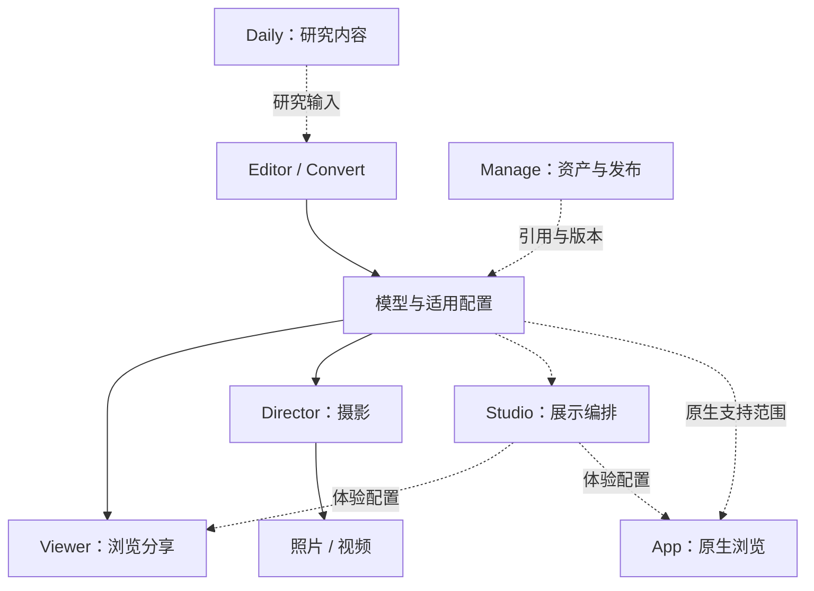

# Metaflow

Metaflow 是围绕 3D Gaussian Splatting（3DGS）的产品与工具体系，覆盖资产处理、模型编辑、场景编排、浏览分享和摄影成片，并延伸到原生客户端与研究内容。各产品按自己的成熟度提供入口，围绕适用资产、场景和机位协作。

[在线 Viewer](https://metaflow.shuang-su.com/) · [在线 Editor](https://metaflow.shuang-su.com/editor/) · [ACG Director 实验](https://metaflow.shuang-su.com/acg/szcaf15/honkai_star_rail-tribbie/director) · [中文文档](docs/README.md) · [开发与验证](docs/maintenance/development.md)

## 产品全景

产品划分沿用 [MF-100 八产品规划](https://github.com/Shuang-su/Metaflow/issues/100)。下表区分正式发布、线上实验、本地成果与规划；详细职责见 [项目概览](docs/getting-started/overview.md)。

| 产品 | 用途 | 当前状态 | 从哪里进入 |
|---|---|---|---|
| **Viewer** | 浏览、漫游、嵌入与分享 3DGS 场景 | 已发布 | [在线体验](https://metaflow.shuang-su.com/acg/yzx/yzx) · [快速开始](docs/getting-started/viewer.md) |
| **Editor** | 模型清理、裁剪、变换、调整与导出 | 已发布 | [在线编辑](https://metaflow.shuang-su.com/editor/) · [使用与开发](docs/getting-started/editor.md) |
| **Convert** | 转换、压缩、LOD 与体素／碰撞等处理 | 已有 CLI 与工具工作；独立产品入口尚未形成 | [工具仓库](https://github.com/Shuang-su/splat-transform) |
| **Manage** | 资产引用、草稿、版本、标签与发布管理 | 规划中 | [首期定义 MF-98](https://github.com/Shuang-su/Metaflow/issues/98) |
| **Studio** | 标点、相机、动画、环境与展示编排 | 已有本地原型与内部交付；尚无正式公开入口 | [产品与原型 MF-58](https://github.com/Shuang-su/Metaflow/issues/58) |
| **Director** | 取景、镜头、景深、照片与视频输出 | 已上线限定 ACG 实验入口；完整摄影研究继续 | [摄影体验](https://metaflow.shuang-su.com/acg/szcaf15/honkai_star_rail-tribbie/director) · [范围 MF-106](https://github.com/Shuang-su/Metaflow/issues/106) |
| **App** | 原生设备上的场景浏览、输入与应用生命周期 | HarmonyOS 阶段实现；完整发布验收未完成 | [NextNews 原生端](https://github.com/Shuang-su/NextNews) · [后续验收 MF-102](https://github.com/Shuang-su/Metaflow/issues/102) |
| **Daily** | 论文、工具与研究内容归档 | 内容仓库可用；门户建设另行推进 | [高斯日报](https://github.com/Shuang-su/gaussian-splatting-daily) · [门户任务](https://github.com/Shuang-su/gaussian-splatting-daily/issues/33) |

### 扩展与插件方向

Nav、粒子开场、动态大气和 XR 是服务于产品的扩展方向。各方向分别推进研究、原型与接入；通用插件运行时、开发者 SDK 和分发机制仍待后续决策。App 是独立原生产品，扩展进入原生端时需要单独声明支持范围。

| 方向 | 目标职责 | 进展入口 |
|---|---|---|
| Nav 导览 | Studio 配置目的地与展示内容，Viewer 提供路线、地图与导览交互 | [MF-97](https://github.com/Shuang-su/Metaflow/issues/97) |
| 粒子开场 | 协调加载反馈、实时揭示与适用工具的确定性视频输出 | [MF-49](https://github.com/Shuang-su/Metaflow/issues/49) · [MF-57](https://github.com/Shuang-su/Metaflow/issues/57) |
| 动态大气 | 分阶段研究天空、天气与场景光照响应 | [MF-52](https://github.com/Shuang-su/Metaflow/issues/52) |
| XR 大空间 | 研究沉浸浏览、设备输入与碰撞协作，按真实设备验收 | [MF-70](https://github.com/Shuang-su/Metaflow/issues/70) |

## 产品如何协作

下图表示产品职责和目标交接关系；各条交接的实现与兼容范围以对应产品记录为准。虚线表示可选纳管、研究输入或仍需独立验收的交接。各工具可直接接收适用输入，Manage 和账号服务不是本地核心工作流的前置条件。



已落地的 Editor → 模型／settings → 资源索引 → Viewer 链路见 [从 Editor 到 Viewer](docs/guides/editor-to-viewer.md)。跨产品资产、作者工程、体验与发布的责任由 [MF-99](https://github.com/Shuang-su/Metaflow/issues/99) 继续梳理；各工具保留自己的工程与支持范围。

## 快速开始

### 在线体验

- **浏览场景：** 打开 [Viewer 示例](https://metaflow.shuang-su.com/acg/yzx/yzx)，或使用已登记的资源链接。
- **编辑模型：** 打开 [Editor](https://metaflow.shuang-su.com/editor/)，操作与导出说明见 [Editor 快速开始](docs/getting-started/editor.md)。
- **拍摄与成片：** 打开 [缇宝 ACG Director](https://metaflow.shuang-su.com/acg/szcaf15/honkai_star_rail-tribbie/director)。实验入口要求 WebGPU 和浮点渲染能力，仅支持已发布 ACG 单文件 SOG／PLY 及已声明环境；流式资源与任意远程模型地址不在该入口范围内。

### 本地运行 Viewer

在仓库根目录开始，使用 [`.nvmrc`](.nvmrc) 指定的 Node.js `20.19.0` 和 npm。运行实际资源前需准备对应 Git LFS 对象；模型下载前检查磁盘空间，只做界面开发无需拉取全部资源。

```bash
cd metaflow-viewer
npm ci
mkdir -p public
# 仅在没有文件、目录或符号链接时创建，保留已有 public/data
if [ ! -e public/data ] && [ ! -L public/data ]; then
  ln -s ../../data public/data
fi
npm run build
npx --no-install serve -s public -l 3000
```

然后打开 [本地示例](http://localhost:3000/acg/yzx/yzx)。`-s` 提供深层资源路径所需的 SPA fallback；若已有 `public/data`，请确认它指向所需数据，失效链接需单独处理。完整准备和持续构建见 [Viewer 快速开始](docs/getting-started/viewer.md)。Editor 与 Director 分别按 [Editor 指南](docs/getting-started/editor.md) 和 [Director 构建说明](metaflow-director/README.md) 运行。

## 当前版本

以下为 **2026-10-18 核对的发布摘要**。各产品独立记录版本；线上实验和规划产品不据此获得统一发布版本。

| 对象 | 当前值 | 上游基线 | 事实来源 |
|---|---|---|---|
| Viewer | 展示／package `5.21.11` | SuperSplat Viewer `1.35.2` / PlayCanvas `2.22.4` | [Version History](metadata/version-history.json) · [发布核验](docs/changes/142-loading-progress/verification.md) |
| Editor | 展示 `1.1` / app `1.1.0` | SuperSplat Editor `2.28.0` | [Version History](metadata/editor-version-history.json) · [运行时版本](metaflow-editor/version.json) |
| 资源索引 | schema `1.2`，100 项资源 | — | [`data/index.json`](data/index.json) |

Viewer 源码位于 `metaflow-viewer/`；当前 Editor 可重建源码位于 `supersplat-v2.28.0/`，`metaflow-editor/` 保存发布构建。Director 的产品定位独立，当前 ACG 入口随 Viewer 发布链路交付，实验依赖版本不能用作 Editor 正式版本。更多边界见 [兼容与版本事实源](docs/reference/compatibility-and-version-sources.md)。

## 文档与贡献

| 需要完成的事 | 文档入口 |
|---|---|
| 理解产品职责与选择工具 | [项目概览](docs/getting-started/overview.md) |
| 查找使用、概念与维护文档 | [中文文档中心](docs/README.md) |
| 将编辑结果接入 Viewer | [Editor 到 Viewer](docs/guides/editor-to-viewer.md) |
| 配置场景、嵌入与分享 | [配置 Viewer](docs/guides/configure-viewer.md) · [嵌入与分享](docs/guides/embed-share.md) |
| 了解源码位置与本地检查 | [仓库地图](docs/reference/repository-map.md) · [开发与验证](docs/maintenance/development.md) |
| 维护发布与部署 | [版本与发布](docs/maintenance/versioning-and-release.md) · [部署](docs/maintenance/deployment.md) |
| 参与贡献与反馈 | [贡献指南](CONTRIBUTING.md) · [Issues](https://github.com/Shuang-su/Metaflow/issues) |

产品方向以 [八产品规划 MF-100](https://github.com/Shuang-su/Metaflow/issues/100) 及各产品任务为入口。贡献时结合当前任务范围与 [MCL v1.0 candidate](docs/metaflow-change-lifecycle-v1.0.md) 的适用边界；候选规范不代表已在全仓激活。

### 最近版本

[Viewer 结构化版本历史](metadata/version-history.json)与[变更总账](docs/metaflow-viewer-change-ledger.md)保存完整版本记录；[Editor 版本历史](metadata/editor-version-history.json)与[变更总账](docs/metaflow-editor-change-ledger.md)独立维护。历史发布恢复与阶段审计从[历史资料入口](docs/history/README.md)查阅。

### URL 查询参数详解

参数列表、编码方式和 route／query 的覆盖顺序见 [Viewer URL 参数参考](docs/reference/viewer-url-parameters.md)；settings 字段见 [Viewer settings schema](docs/reference/viewer-settings-schema.md)。
