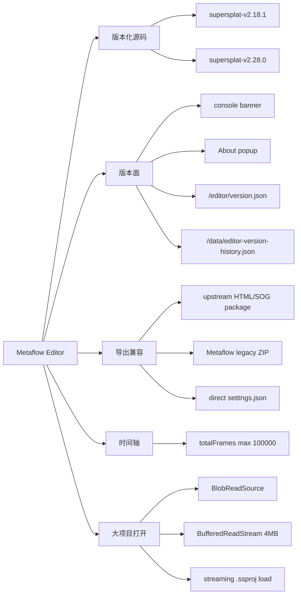
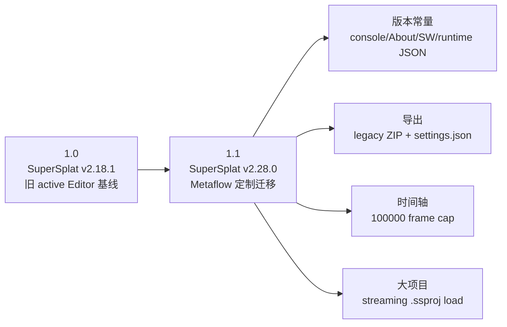

# Metaflow Editor 变更总账

本文档记录 Metaflow Editor 相对 upstream SuperSplat Editor 的同步点、源码级定制和导出兼容策略。结构化版本号的权威来源是 [`metadata/editor-version-history.json`](../metadata/editor-version-history.json)，公开生成物是 [`data/editor-version-history.json`](../data/editor-version-history.json) 与 `/editor/version.json`。

它不是 upstream changelog 的重排，而是用于回答：

- 当次同步基于哪个 SuperSplat Editor 版本；
- Metaflow 保留或新增了哪些源码级行为；
- `/editor`、导出包、直接 `settings.json` 和长动画编辑的用户结果是什么；
- 下次 upstream 合并时哪些文件必须重新核对。

当前操作入口见 [Editor 快速开始](getting-started/editor.md)，稳定导出行为见 [Editor 导出契约](reference/editor-export-contract.md)。总账保留每个阶段的版本事实，不把历史值改写为当前值。

## 5.25.1 Studio 候选配套构建

源代码检查点 `65417c1dc7c3f58b01285381198e2ec9a44e2a2f`，来自先前已验证的 1.4.0 候选 `9b3774101ef3637ab42ce573fd7ee922b35d09b8`。默认版由 SuperSplat 3.9.2、PlayCanvas 2.24.2 和 SplatTransform 3.12.0 构建。独立 SOG 默认 v3，显式 v2 继续可用。默认及 WebGL2 兼容 Editor 的普通和渐变离线包随正式 Viewer runtime 重建，配套产品检查点为 `88c356ee5dc013614eaa6ad83389bfc340ddff81`。

## 审计规则

| 字段 | 含义 |
|---|---|
| 动机 / 原行为 | 版本要解决的问题，以及修改前用户能观察到的状态 |
| 上游基线 | 同步到的 SuperSplat Editor tag、commit 和关键依赖 |
| 具体改动 / 实现 | 从源码、构建产物、生成数据和测试归纳出的实现事实 |
| 用户结果 | 在线 `/editor`、导出包、直接 settings JSON 或项目打开行为的实际变化 |
| 风险 / 后续 | 下次上游同步时需要重新核对的兼容边界 |
| 证据 | 版本化源码目录、构建产物、生成数据和测试入口 |

功能、同步和发布版本必须同时更新结构化历史与本总账。纯文档维护不单独形成 Editor 产品版本。

## 能力树

## 上游同步链

## 版本记录

| 版本 | 动机与原行为 | 上游基线 | 具体改动与实现 | 用户结果 | 风险、后续与证据 |
|---|---|---|---|---|---|
| `1.0` | 保留旧 active Editor 作为可审计基线；此前只有本地备份目录，不符合 viewer 的版本化源码目录习惯。 | SuperSplat Editor `v2.18.1`；`@playcanvas/splat-transform 1.2.0`、`@playcanvas/pcui 5.5.0`、`playcanvas 2.15.3`。 | 将旧源码基线命名为 `supersplat-v2.18.1/`，只保留源码、配置、lockfile、静态资源和 README；移除本机 `.git/`、`node_modules/`、`dist/`。 | 维护者可以像查看 `supersplat-viewer-v*` 一样直接打开旧 Editor 基线，用于对比和回退判断。 | 该版本不是当前线上运行版本，时间轴仍是 upstream `10000` 上限；证据为 `supersplat-v2.18.1/` 和 `metadata/editor-version-history.json` 的 `1.0` entry。 |
| `1.1` | 旧 `/editor` 缺少 v2.28.0 的大项目打开改进，且 Metaflow 的导出、长时间轴和版本面需要在源码层保留。 | SuperSplat Editor `v2.28.0` / `9f4dfe1`；`@playcanvas/splat-transform 2.5.1`、`@playcanvas/supersplat-viewer 1.26.3`、`@playcanvas/pcui 6.1.4`、`playcanvas 2.19.2`。 | 将 active 源码命名为 `supersplat-v2.28.0/`；新增 `src/metaflow-editor-version.ts`；console/About/SW/runtime JSON 显示 `Metaflow Editor 1.1`；`src/ui/timeline-panel.ts` 保持 `100000`；`src/ui/export-popup.ts`、`src/file-handler.ts`、`src/splat-serialize.ts` 保留 upstream HTML/SOG package，同时增加 legacy ZIP 和直接 `settings.json`。 | `/editor` 对外显示 Metaflow Editor 1.1；用户可继续导出包含 `settings.json` 和 `scene.compressed.ply` 的 legacy ZIP，也可直接导出 `settings.json`；大 `.ssproj` 打开路径保留 upstream streaming 读取能力。 | 下次 upstream 合并必须复核 `splat-serialize.ts`、`file-handler.ts`、`export-popup.ts`、`timeline-panel.ts`、`sw.ts`、`metaflow-editor-version.ts`；大 `.ssproj` 保存后重开测试本轮仍未作为自动化覆盖。证据为 `supersplat-v2.28.0/`、`metaflow-editor/`、`metaflow-viewer/tests/editor-version-history.test.mjs`。 |

## 固定检查清单

- `supersplat-v2.28.0/src/metaflow-editor-version.ts` 是运行时版本标签、console banner 和 service worker cache name 的源码入口。
- `metadata/editor-version-history.json` 是 Editor 版本历史源；运行 `python3 scripts/generate_editor_version.py` 后必须生成匹配的 `data/editor-version-history.json` 和 `metaflow-editor/version.json`。
- `supersplat-v2.28.0/src/ui/timeline-panel.ts` 的 `totalFrames.max` 必须保持 `100000`。
- `supersplat-v2.28.0/src/splat-serialize.ts` 必须同时保留 `html`、`zip`、`legacyZip`、`settingsJson` 四种 viewer 导出路径。
- legacy ZIP 必须包含 `index.html`、`index.css`、`index.js`、`settings.json`、`scene.compressed.ply`。
- upstream 大项目打开优化保留在 `supersplat-v2.28.0/src/doc.ts` 和 `supersplat-v2.28.0/src/io/read/file-systems.ts`；下次同步需要补大 `.ssproj` 保存后重开验证。

## 1.2.0 — MF-148 release candidate (2026-10-21)

**Publication is pending GitHub access, final merge/tag and Netlify promotion.** The current production remains 1.1.0 until live readback confirms otherwise. This entry records the candidate's implementation, not a completed deployment.

- Upstream: `v3.5.2` / `f2a1b4975b4766e0ee0c95e63c2737dc2ecb6e5b`, PlayCanvas 2.23.0. Default source is `supersplat-v3.5.2/`, WebGPU only.
- The separate `/editor-legacy/` edition uses `supersplat-v2.32.5/` / `e060989b202548848eb440a5005cd41a8b26f7db`, WebGL2. Both editions carry product `1.2.0`, with distinct upstream/runtime identities and both customization groups.
- Preserve branding, 100000 frames, upstream HTML/Package, legacy ZIP with its five fixed files, and standalone settings.json. Import/reopen and output framing are regression-tested, with original assets untouched.
- Integrate MF-57 particle video, character/scene profiles, fixed frame/camera synchronization, success-only file commit, cancellation/error recovery. Adapt the canonical Viewer shader to the 3.x compute projector; stable source-index slots make offline equal-depth sorting reproducible. The realtime view retains upstream compaction.
- Retire the pre-1.2 offline SW at its old URL; only Editor-owned cache names are removed, and unsaved tabs are not reloaded. Both editions use revalidated HTTP assets.
- Stage only fresh builds: build-time source digest, runtime bundle hash and mirror file manifest must match. Publish the exact validated complete candidate, preserving Viewer/Director/resource bytes.
- Scope excludes Studio/annotation authoring, accounts/uploads, 360-degree particle capture, dynamic-sequence particles and public Viewer download.
- Local implementation checkpoint: `3aa6ed69b810eb3f41cee23dbbe72589fa0bdd36`. [Spec](changes/148-editor-upstream-v3.5.2/spec.md), [plan](changes/148-editor-upstream-v3.5.2/plan.md), [validation and release status](changes/148-editor-upstream-v3.5.2/verification.md). Final product/tag/deploy identities will be appended after their respective operations.

- Local release-ready product checkpoint: `83ef04a7c4ffdea5625047f120b7a139aaa2df8c`. Runtime/history now reference this actual local product commit. GitHub merge SHA, tag and deployment remain pending; this record does not claim production publication.

## 2026-10-21 — Editor 1.2.0 production via authorized CLI

The user authorized direct Netlify CLI publication of the already locally validated product `83ef04a7c4ffdea5625047f120b7a139aaa2df8c` while GitHub access was suspended, then explicitly cancelled additional testing/observation. Final deployment `6ad8aa70b39fb4902864eca3` published at `2026-10-21T20:05:30.898000+08:00` (Asia/Shanghai), with default SuperSplat 3.5.2 at `/editor/` and WebGL2 compatibility 2.32.5 at `/editor-legacy/`; both retain particle video and existing Metaflow exports/timeline customizations. Actual version files, JS hashes and cache policy were read back. Viewer/Director/model payloads remain the verified production bytes.

The CLI resolver required a pinned task-local deployment base to avoid inheriting the parent checkout's old cache rules. Final Editor resources and history revalidate correctly. Local validation is documented above; no completed online browser export or 15-minute observation is claimed. GitHub push/PR/merge/remote tag remain pending. Rollback is deployment `6ad3e0b5c31b278f83e88096`. See [release record](changes/148-editor-upstream-v3.5.2/verification.md).

## `1.3.0` · `1074d34f9db25729e9d6abf14d1fb13f084d1b22` · gradient background product

两版 Editor 新增纯色/线性/径向填充弹层、可增删拖动色标、透明度、方向与径向几何；一次拖动一条撤销，背景随工程保存。真实 GPU 合成覆盖图片、普通/粒子视频和 360°；透明输出跳过背景。渐变使用自包含 Metaflow Viewer 导出，保留单文件 HTML、SOG Package、legacy ZIP 五文件结构与 version-2 settings。

定向本地验收、失败修复和实际发布状态见 [本轮验证](changes/editor-gradient-background/verification.md)。上游与依赖版本固定；Director、模型与资源 settings 不在本次变更范围。GitHub 403 阻塞远端同步；本地产品提交与 CLI 部署分别记录。

Editor 1.3.0 was published at 2026-10-22T11:08:05.861Z in deploy `6ad9ee70ea6b55163656a72f` with Viewer 5.23.0. A legacy RGBA settings compatibility defect in the shared runtime was found after artifact readback. The full prior site `6ad8aa70b39fb4902864eca3` was restored at 2026-10-22T11:12:42.387Z. Recovery is tracked as 1.3.1; this 1.3.0 release record is retained.

## `1.3.1` · `3c95767645a506dbe311d3ecce59380c011fe780` · legacy RGBA recovery

共享背景采样统一归一化为 RGB，兼容 version-2 历史 RGBA 配置并保留原数据。此前渐变发布已回退，本条记录兼容修复与恢复版本，不覆盖原发布历史。实际本地检查及部署身份见 [验证记录](changes/editor-gradient-background/verification.md)。

Recovery 1.3.1 production confirmed: deploy `6ad9f33ef3986bec2802fc18` at 2026-10-22T11:28:36.647Z (19:28:36 Asia/Shanghai), product `3c95767645a506dbe311d3ecce59380c011fe780`, release build `92011171c8ebe337d0c47ffc2f7fb8bb4cb7b96f`. Nineteen public hashes/cache policies match; 10,225 retained site files remain identical. Rollback `6ad8aa70b39fb4902864eca3` is retained. GitHub synchronization remains blocked by 403; no extra online functional tests or observation were run. [Readback evidence](changes/editor-gradient-background/production-1.3.1-readback.json).

## `1.3.2` · `7dedcfb65d0a61751b32393f263293ed3e7ef40e` · background picker UX correction

两版 Editor 的背景入口与相邻色块同宽同高；弹层采用原生 PCUI 字体、暗色、控件和紧凑间距。新增内嵌 SV 色盘、色相／色标透明度条、HEX/RGB 切换；保留色相、色标身份及渐变模式记忆。数值支持标签拖动及 Option/Alt 拖动，左右调值、上下四档变速；单次撤销、取消恢复和指针锁定拒绝后的捕获回退均有定向验证。普通拖动使用绝对指针捕获，接近视口边缘时才请求连续指针锁定，避免快速切换造成的跳值。

产品 checkpoint 为 `7dedcfb65d0a61751b32393f263293ed3e7ef40e`。Viewer 保持 5.23.1，背景契约、渲染与所有依赖基线不变。实际检查、失败修复及部署身份追加到 [验证记录](changes/editor-gradient-background/verification.md)；本段建立时仍待候选站发布，不把本地构建当作线上发布。

Editor 1.3.2 production confirmed: deployment `6ada23d5f9932a76c8050090`, published 2026-10-22T14:55:54.293Z (22:55:54 Asia/Shanghai), product `7dedcfb65d0a61751b32393f263293ed3e7ef40e`, release build `682569679da2185bc0cf9ed3e64a2cc6b48d356f`. Nineteen public artifact/cache checks pass and 10,238 non-Editor files are preserved. Viewer remains 5.23.1. Rollback: `6ad9f33ef3986bec2802fc18`. GitHub synchronization remains blocked by account suspension. [Release evidence](changes/editor-gradient-background/production-1.3.2-readback.json).

## `1.4.0` · `05436315bb4a81d9e24a92f62b451c349519d57a` · Studio 本地候选

默认 Edition 按锁文件使用 SuperSplat 3.9.2、PlayCanvas 2.24.2 与 SplatTransform 3.12.0。兼容 Edition 继续使用 SuperSplat 2.32.5 的锁定依赖。两套镜像按正式构建和字节校验流程生成。

- `9b3774101ef3637ab42ce573fd7ee922b35d09b8` · 补齐正式镜像的色盘低视窗定位，保留原候选构建提交的记录。

### `1.4.0` · 2026-11-27 · `3fa19fdb314f5b726403b0912228842f433c00b2`

默认 SuperSplat 3.9.2，兼容 SuperSplat 2.32.5。正式镜像按锁文件构建，并核对独立 SOG v3/v2 与普通、渐变 HTML/ZIP 的离线复开。 [发布记录](https://github.com/Shuang-su/Metaflow/pull/200)

PR 200 补录 1.2.0 至 1.3.2 的历史追踪。原产品提交、历史日期和 Netlify 部署号均沿用之前的发布记录。
